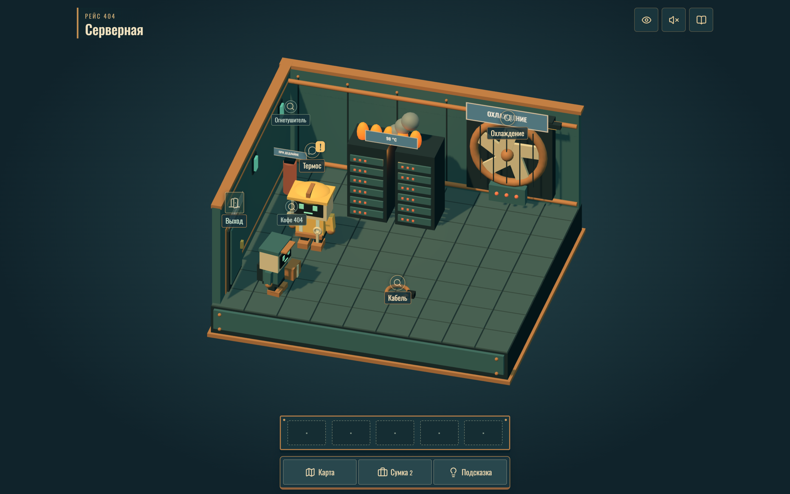
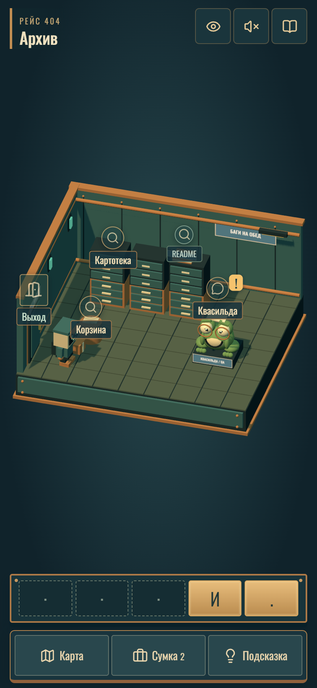

# Пакет не доставлен

**Посылка есть. Адрес исчез. Поможем курьеру?**

Браузерный 3D-квест о маленьком роботе и большом сбое доставки. Исследуйте цифровой город, знакомьтесь с его обитателями, чините механизмы и собирайте потерянный адрес. Программировать не нужно — помогут внимательность, логика и немного любопытства.

**[Скачать игру](https://github.com/kryukovilya/packet-quest-3d/releases/latest)**

## Приключение внутри цифрового города

- Шесть локаций со своими героями и секретами.
- Головоломки с механизмами, пропуском и ребусом.
- Роботы с характером, IT-шутки и Квасильда — лягушка, которая любит баги.
- Объёмные сцены, анимации, музыка и звуки.
- Управление мышью или касаниями на телефоне.

## Как играть

Нажимайте на двери, персонажей и предметы в комнате. Исследуйте отделы, решайте головоломки и собирайте фрагменты адреса. Карта, сумка и подсказка всегда под рукой. Прогресс сохраняется автоматически.

## Запуск

Скачайте `packet-quest-3d-v1.0.2-server.zip` в [разделе релизов](https://github.com/kryukovilya/packet-quest-3d/releases/latest), распакуйте и откройте `index.html` в современном браузере.

Для игры по ссылке с телефона разместите содержимое архива на статическом HTTPS-сервере.

Шрифт [Oswald](OFL-Oswald.txt) распространяется по SIL Open Font License. Лицензии библиотек включены в архив игры.
